<a href="https://jeetstack.com/"><picture><source media="(prefers-color-scheme: dark) and (max-width: 600px)" srcset="assets/hero.20261126oss-phone-dark.svg"><source media="(max-width: 600px)" srcset="assets/hero.20261126oss-phone-light.svg"><source media="(prefers-color-scheme: dark)" srcset="assets/hero.20261126oss-dark.svg">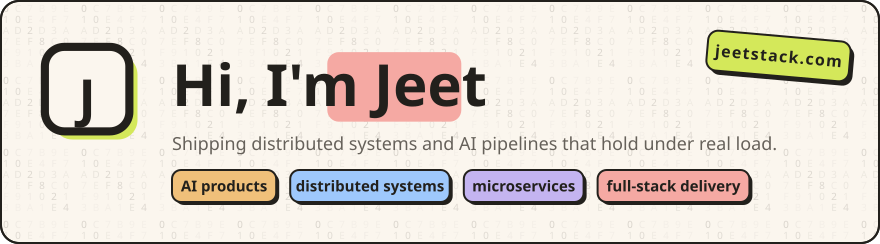</picture></a>

<a href="https://www.linkedin.com/in/bishwajeet-kumar-2b044a14a/"><picture><source media="(prefers-color-scheme: dark)" srcset="assets/badge-li.20261126oss-dark.svg"></picture></a>
<a href="https://github.com/github-bishwajeet"><picture><source media="(prefers-color-scheme: dark)" srcset="assets/badge-gh.20261126oss-dark.svg"></picture></a>
<a href="https://github.com/jeet-scenarix-ai"><picture><source media="(prefers-color-scheme: dark)" srcset="assets/badge-work.20261126oss-dark.svg"></picture></a>
<a href="https://jeetstack.com/"><picture><source media="(prefers-color-scheme: dark)" srcset="assets/badge-site.20261126oss-dark.svg"></picture></a>
<a href="https://www.crio.do/learn/portfolio/bishwajeetk003/"><picture><source media="(prefers-color-scheme: dark)" srcset="assets/badge-crio.20261126oss-dark.svg"></picture></a>

<picture><source media="(prefers-color-scheme: dark) and (max-width: 600px)" srcset="assets/github.20261126oss-phone-dark.svg"><source media="(max-width: 600px)" srcset="assets/github.20261126oss-phone-light.svg"><source media="(prefers-color-scheme: dark)" srcset="assets/github.20261126oss-dark.svg">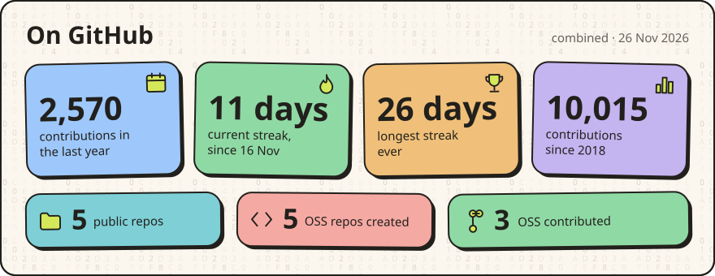</picture>

<picture><source media="(prefers-color-scheme: dark) and (max-width: 600px)" srcset="assets/graph-6m.20261126oss-phone-dark.svg"><source media="(max-width: 600px)" srcset="assets/graph-6m.20261126oss-phone-light.svg"><source media="(prefers-color-scheme: dark)" srcset="assets/graph-6m.20261126oss-dark.svg">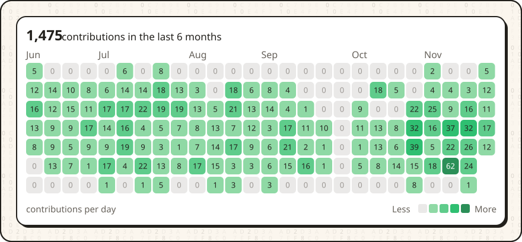</picture>

Last 12 months: 2,570 contributions

<picture><source media="(prefers-color-scheme: dark) and (max-width: 600px)" srcset="assets/graph-12m.20261126oss-phone-dark.svg"><source media="(max-width: 600px)" srcset="assets/graph-12m.20261126oss-phone-light.svg"><source media="(prefers-color-scheme: dark)" srcset="assets/graph-12m.20261126oss-dark.svg">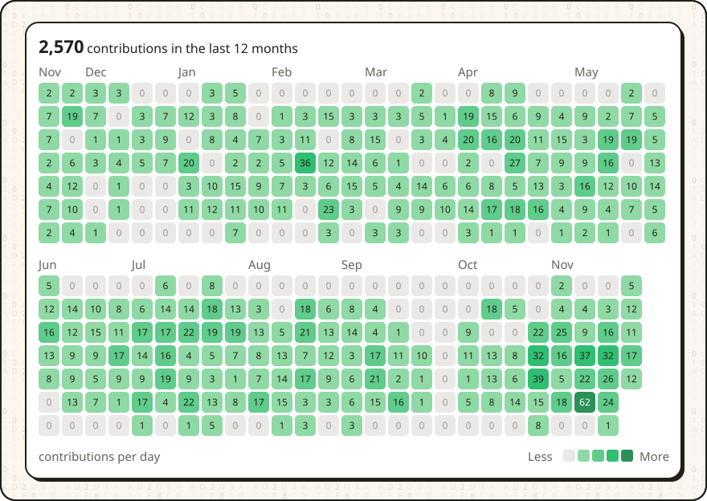</picture>

2026: 2,427 contributions

<picture><source media="(prefers-color-scheme: dark) and (max-width: 600px)" srcset="assets/graph-2026.20261126oss-phone-dark.svg"><source media="(max-width: 600px)" srcset="assets/graph-2026.20261126oss-phone-light.svg"><source media="(prefers-color-scheme: dark)" srcset="assets/graph-2026.20261126oss-dark.svg">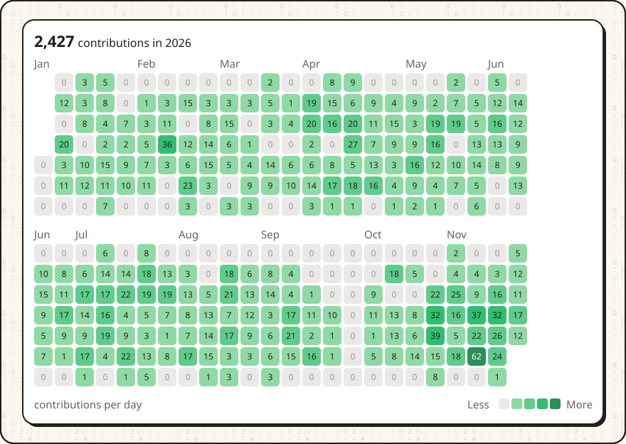</picture>

2025: 2,696 contributions

<picture><source media="(prefers-color-scheme: dark) and (max-width: 600px)" srcset="assets/graph-2025.20261126oss-phone-dark.svg"><source media="(max-width: 600px)" srcset="assets/graph-2025.20261126oss-phone-light.svg"><source media="(prefers-color-scheme: dark)" srcset="assets/graph-2025.20261126oss-dark.svg">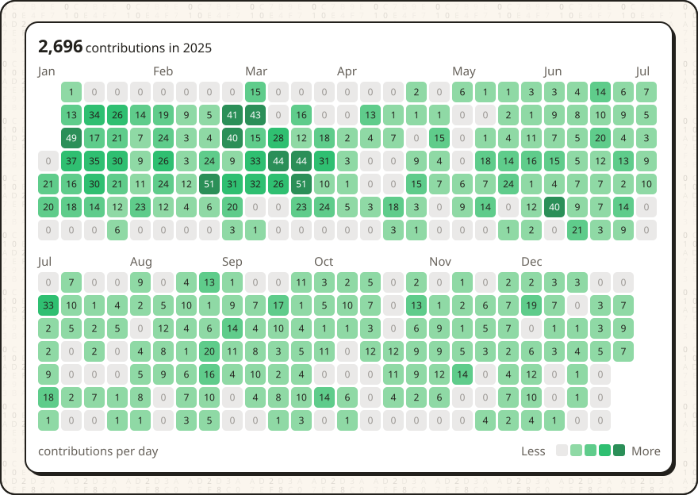</picture>

2024: 1,989 contributions

<picture><source media="(prefers-color-scheme: dark) and (max-width: 600px)" srcset="assets/graph-2024.20261126oss-phone-dark.svg"><source media="(max-width: 600px)" srcset="assets/graph-2024.20261126oss-phone-light.svg"><source media="(prefers-color-scheme: dark)" srcset="assets/graph-2024.20261126oss-dark.svg">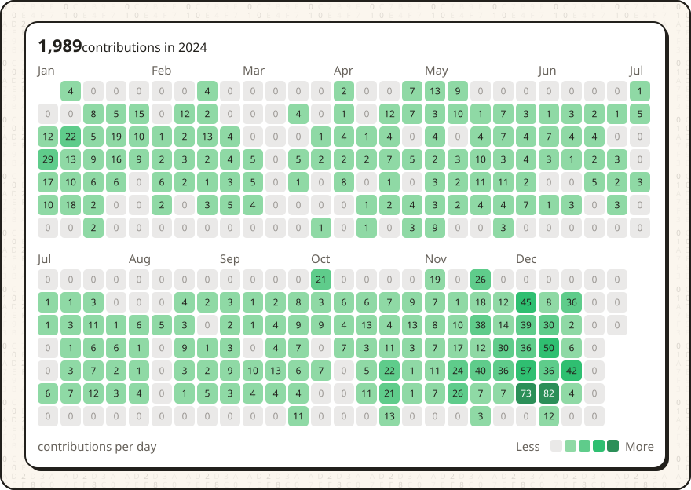</picture>

2023: 1,079 contributions

<picture><source media="(prefers-color-scheme: dark) and (max-width: 600px)" srcset="assets/graph-2023.20261126oss-phone-dark.svg"><source media="(max-width: 600px)" srcset="assets/graph-2023.20261126oss-phone-light.svg"><source media="(prefers-color-scheme: dark)" srcset="assets/graph-2023.20261126oss-dark.svg">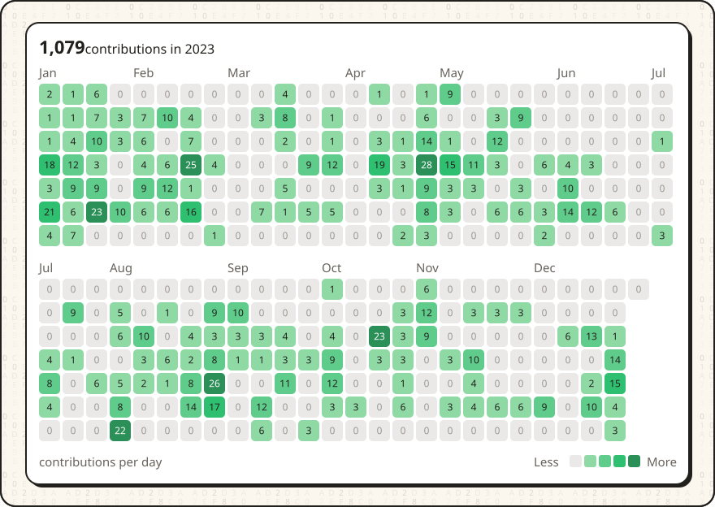</picture>

2022: 1,102 contributions

<picture><source media="(prefers-color-scheme: dark) and (max-width: 600px)" srcset="assets/graph-2022.20261126oss-phone-dark.svg"><source media="(max-width: 600px)" srcset="assets/graph-2022.20261126oss-phone-light.svg"><source media="(prefers-color-scheme: dark)" srcset="assets/graph-2022.20261126oss-dark.svg">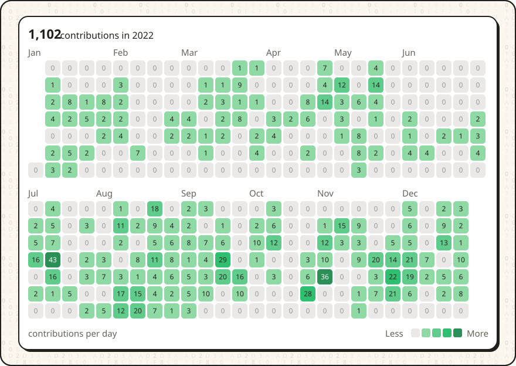</picture>

2021: 546 contributions

<picture><source media="(prefers-color-scheme: dark) and (max-width: 600px)" srcset="assets/graph-2021.20261126oss-phone-dark.svg"><source media="(max-width: 600px)" srcset="assets/graph-2021.20261126oss-phone-light.svg"><source media="(prefers-color-scheme: dark)" srcset="assets/graph-2021.20261126oss-dark.svg">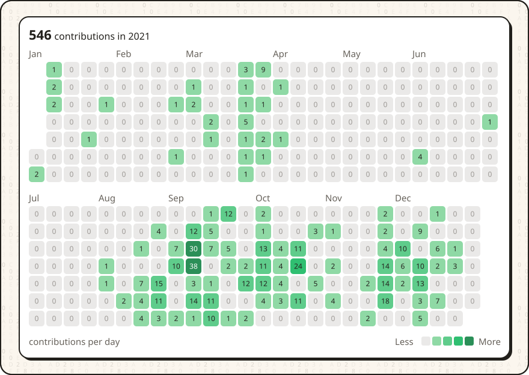</picture>

2020: 175 contributions

<picture><source media="(prefers-color-scheme: dark) and (max-width: 600px)" srcset="assets/graph-2020.20261126oss-phone-dark.svg"><source media="(max-width: 600px)" srcset="assets/graph-2020.20261126oss-phone-light.svg"><source media="(prefers-color-scheme: dark)" srcset="assets/graph-2020.20261126oss-dark.svg">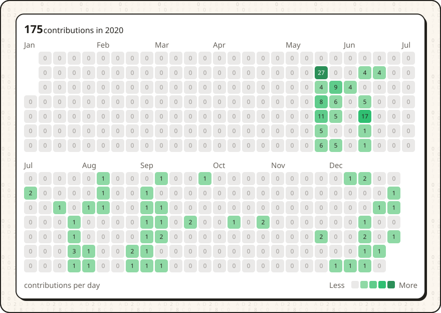</picture>

2019: 0 contributions

<picture><source media="(prefers-color-scheme: dark) and (max-width: 600px)" srcset="assets/graph-2019.20261126oss-phone-dark.svg"><source media="(max-width: 600px)" srcset="assets/graph-2019.20261126oss-phone-light.svg"><source media="(prefers-color-scheme: dark)" srcset="assets/graph-2019.20261126oss-dark.svg">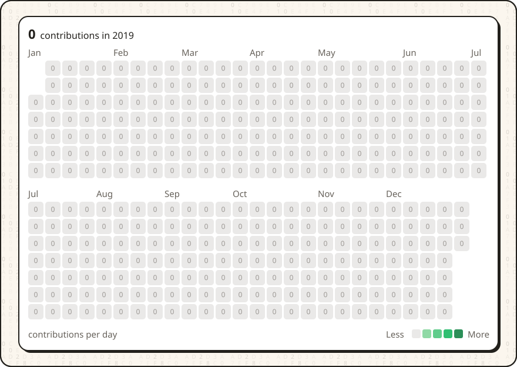</picture>

2018: 1 contribution

<picture><source media="(prefers-color-scheme: dark) and (max-width: 600px)" srcset="assets/graph-2018.20261126oss-phone-dark.svg"><source media="(max-width: 600px)" srcset="assets/graph-2018.20261126oss-phone-light.svg"><source media="(prefers-color-scheme: dark)" srcset="assets/graph-2018.20261126oss-dark.svg">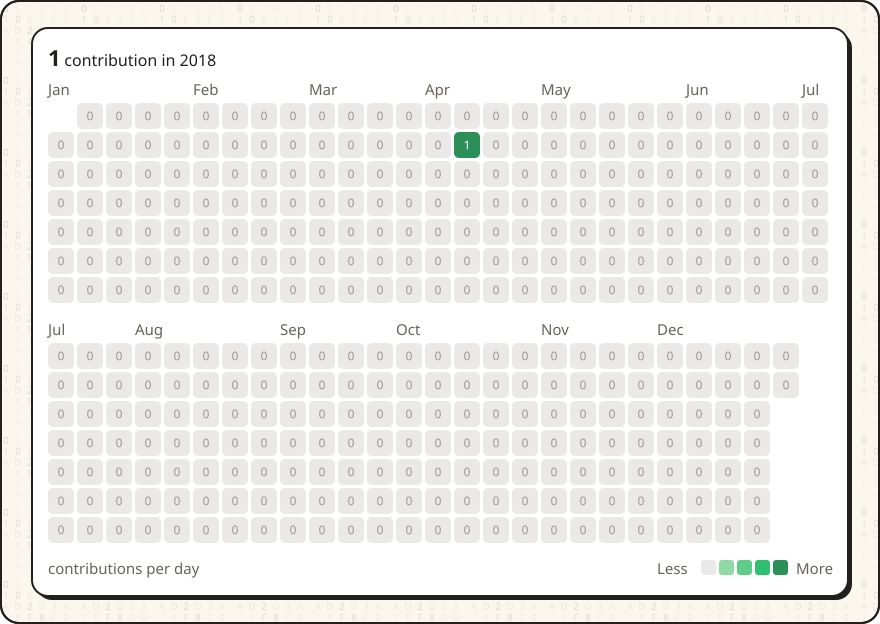</picture>

<picture><source media="(prefers-color-scheme: dark) and (max-width: 600px)" srcset="assets/line-30d.20261126oss-phone-dark.svg"><source media="(max-width: 600px)" srcset="assets/line-30d.20261126oss-phone-light.svg"><source media="(prefers-color-scheme: dark)" srcset="assets/line-30d.20261126oss-dark.svg">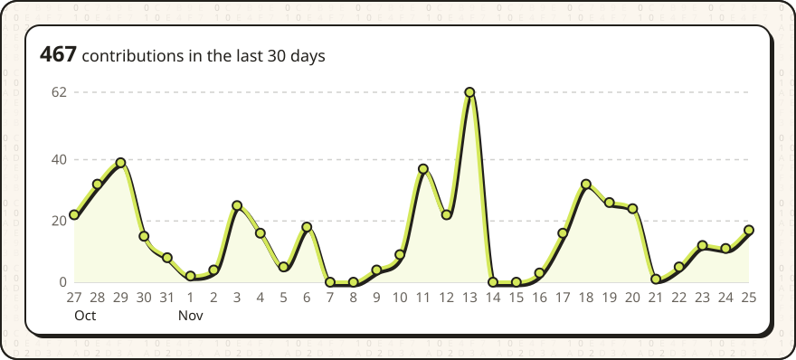</picture>

<picture><source media="(prefers-color-scheme: dark) and (max-width: 600px)" srcset="assets/whoami.20261126oss-phone-dark.svg"><source media="(max-width: 600px)" srcset="assets/whoami.20261126oss-phone-light.svg"><source media="(prefers-color-scheme: dark)" srcset="assets/whoami.20261126oss-dark.svg"></picture>

<picture><source media="(prefers-color-scheme: dark) and (max-width: 600px)" srcset="assets/label-ship.20261126oss-phone-dark.svg"><source media="(max-width: 600px)" srcset="assets/label-ship.20261126oss-phone-light.svg"><source media="(prefers-color-scheme: dark)" srcset="assets/label-ship.20261126oss-dark.svg"></picture>

<a href="https://github.com/jeet-scenarix-ai"><picture><source media="(prefers-color-scheme: dark) and (max-width: 600px)" srcset="assets/app-studiojadu.20261126oss-phone-dark.svg"><source media="(max-width: 600px)" srcset="assets/app-studiojadu.20261126oss-phone-light.svg"><source media="(prefers-color-scheme: dark)" srcset="assets/app-studiojadu.20261126oss-dark.svg">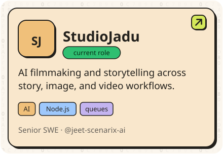</picture></a>
<a href="https://jeetstack.com/"><picture><source media="(prefers-color-scheme: dark) and (max-width: 600px)" srcset="assets/app-mdware.20261126oss-phone-dark.svg"><source media="(max-width: 600px)" srcset="assets/app-mdware.20261126oss-phone-light.svg"><source media="(prefers-color-scheme: dark)" srcset="assets/app-mdware.20261126oss-dark.svg">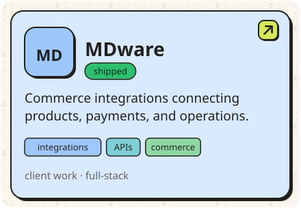</picture></a>
<a href="https://jeetstack.com/"><picture><source media="(prefers-color-scheme: dark) and (max-width: 600px)" srcset="assets/app-valora-homes.20261126oss-phone-dark.svg"><source media="(max-width: 600px)" srcset="assets/app-valora-homes.20261126oss-phone-light.svg"><source media="(prefers-color-scheme: dark)" srcset="assets/app-valora-homes.20261126oss-dark.svg">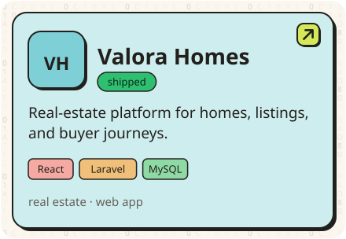</picture></a>
<a href="https://jeetstack.com/"><picture><source media="(prefers-color-scheme: dark) and (max-width: 600px)" srcset="assets/app-gaesthetic-room.20261126oss-phone-dark.svg"><source media="(max-width: 600px)" srcset="assets/app-gaesthetic-room.20261126oss-phone-light.svg"><source media="(prefers-color-scheme: dark)" srcset="assets/app-gaesthetic-room.20261126oss-dark.svg">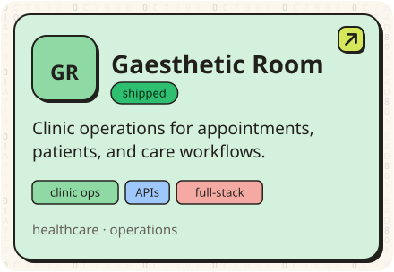</picture></a>

more ships: <a href="https://jeetstack.com/">Uprising Homes</a> · <a href="https://jeetstack.com/">Calgary Lending</a> · <a href="https://jeetstack.com/">Satnam Floral Design</a> · <a href="https://jeetstack.com/">Merge Community Services</a> · <a href="https://jeetstack.com/">Kaler Contracting</a>

Drawn in a ZazaG-style design system · numbers redrawn every night by a GitHub Action · <a href="https://jeetstack.com/">jeetstack.com</a>

